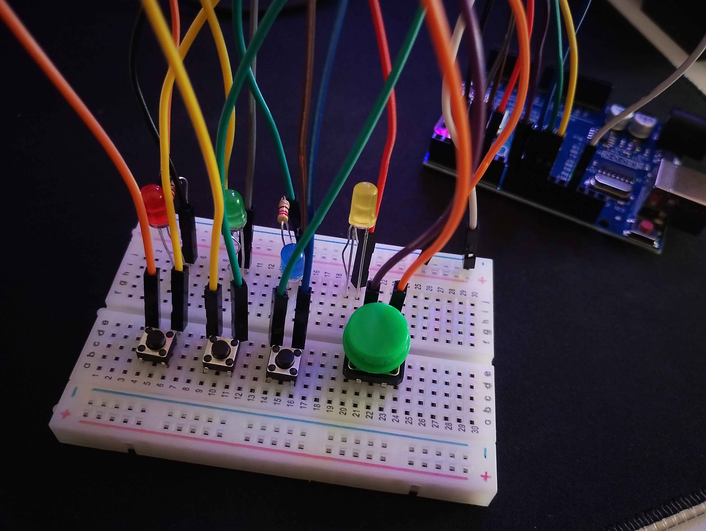
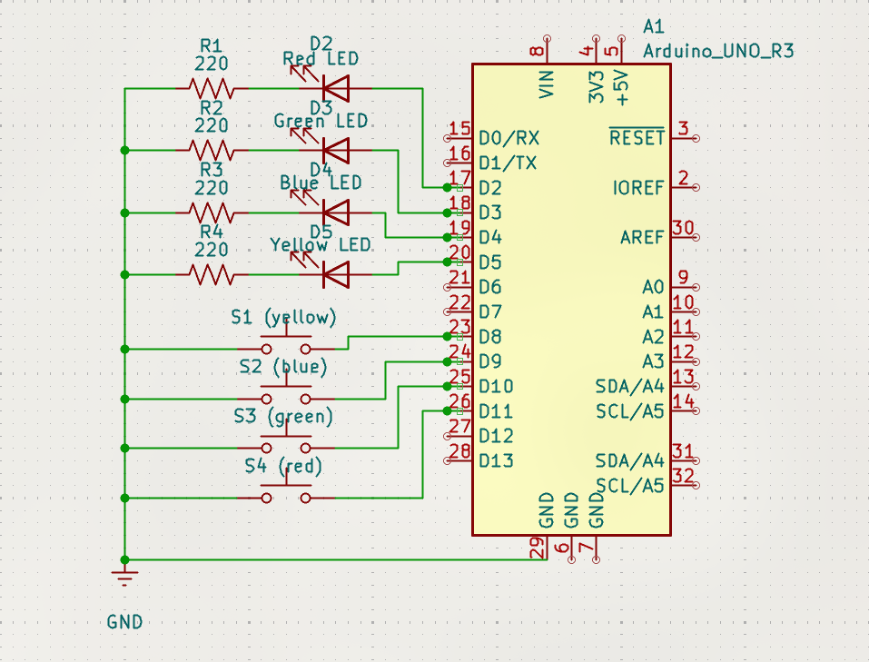
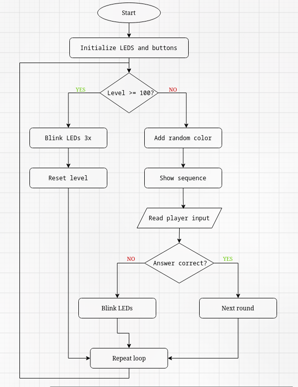

# Arduino Memory Game

## Table of Contents

- [Introduction](#introduction)
- [How to Play](#how-to-play)
- [Components Used](#components-used)
- [Circuit Connections](#circuit-connections)
- [Project](#project)
- [Schematic](#schematic)
- [Flowchart](#flowchart)
- [Program Logic](#program-logic)

## Introduction

It's a memory game built with an Arduino Uno, four LEDs, and four push buttons. The player must memorize and repeat a long sequence of colors, each successful round adds another color to the sequence

## How to Play

1. The game starts by flashing all four LEDs
2. Watch the color sequence
3. Repeat it using the buttons
4. Each time you get it right, one more color is added
5. If you press the wrong button and the game restarts after flashing all the LEDs 3x times

## Components Used

| Component | Quantity |
|---|---:|
| Arduino Uno | 1 |
| Red LED | 1 |
| Green LED | 1 |
| Blue LED | 1 |
| Yellow LED | 1 |
| Push buttons | 4 |
| 220 ohms resistors | 4 |
| Small Breadboard | 1 |
| Jumper wires | as needed |
| USB cable | 1 |

## Circuit Connections

### LEDs

| LED Color | Arduino Pin |
|---|---|
| Red | D2 |
| Green | D3 |
| Blue | D4 |
| Yellow | D5 |

Each LED is connected in series with a 220 ohms resistor

### Push Buttons

| Button Color | Arduino Pin |
|---|---|
| Red | D11 |
| Green | D10 |
| Blue | D9 |
| Yellow | D8 |

## Project 

[Watch how it works](https://drive.google.com/file/d/1HP4qO8y5PqCqODM1RqhgGiDpZPVvoaSP/view)

## Schematic

## Flowchart

## Program Logic

The program is organized into several functions:

- `setup()` — Initializes the LEDs and buttons, seeds the random number generator, and plays a startup animation
- `loop()` — Adds a random color to the sequence, displays it, checks the player's input, and handles game resets
- `showSequence()` — Flashes the LEDs in the current sequence
- `waitForButton()` — Waits for a button press and returns the corresponding color
- `playerGuessedCorrectly()` — Checks whether the player's input matches the sequence
- `endGame()` — Flashes all LEDs three times to signal the end of a round

The game stores the sequence in an array and uses loops to display and verify it
